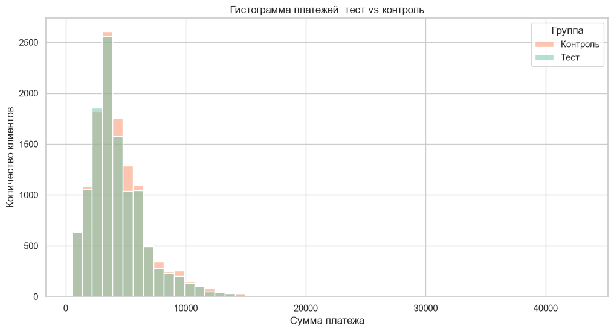
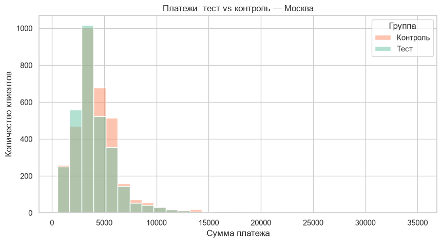
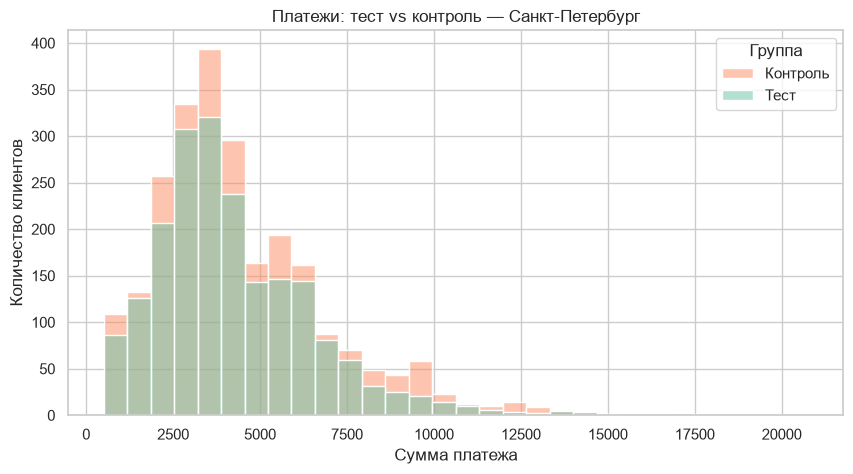
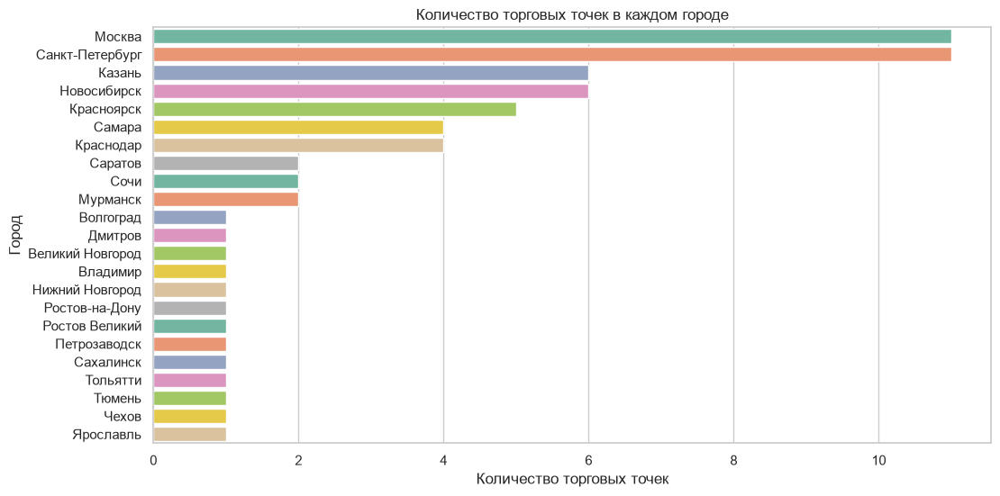
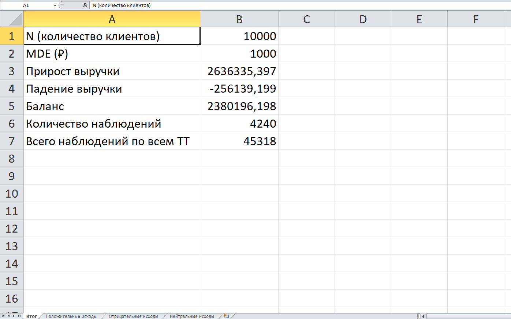

# 📊 A/B-тест для SkyLenta: Анализ эффективности пуш-уведомлений

**Дипломный проект курса «Аналитик данных» Skypro**

---

## 📌 Описание проекта

**Бизнес-задача:** Ретейлер SkyLenta тестирует новый формат маркетинговых коммуникаций — пуш-уведомления вместо баннеров в приложении. Необходимо оценить, какой формат эффективнее по конверсии в покупку и среднему чеку.

**Роль:** Системный аналитик / Data Analyst  
**Период:** 2026  
**Объём данных:** 55 356 клиентов, 35 560 платежей, 51 торговая точка в 23 городах

---

## 🛠 Стек технологий

- **Языки:** Python 3.14
- **Библиотеки:** pandas, NumPy, matplotlib, seaborn, scipy
- **Статистика:** t-критерий Стьюдента, критерий Манна-Уитни
- **Инструменты:** Jupyter Notebook, VS Code, Excel (xlsxwriter)
- **Методы:** EDA, A/B-тестирование, сегментация

---

## 📁 Структура проекта

skylenta-ab-test-analysis/
├── diploma_skyLenta.ipynb # Полный код анализа
├── skylenta_ab_calculator.xlsx # Excel-калькулятор бизнес-эффекта
├── skylenta_ab_report.xlsx # Отчёт по 51 торговой точке
└── images/ # Визуализации
├── histogram_payments.png # Общая гистограмма платежей
├── histogram_moscow.png # Гистограмма по Москве
├── histogram_saint_petersburg.png # Гистограмма по СПб
├── barplot_cities.png # ТТ по городам
└── calculator_itog.png # Лист "Итог" калькулятора

---

## 📊 Результаты анализа

### Общие результаты A/B-теста

| Метрика | Тест | Контроль | p-value | Вывод |
|---------|------|----------|---------|-------|
| Средний чек | выше | ниже | < 0.0001 | ✅ Значимая разница |
| Конверсия | 51.27% | 48.73% | < 0.0001 | ✅ Значимая разница |
| Распределения | — | — | < 0.0001 | ✅ Значимо различаются |

---

##  Визуализации

### Распределение платежей (все города)

### Сегмент: Москва

### Сегмент: Санкт-Петербург

### Торговые точки по городам

---

## 🗺 Сегментация по городам

- **Москва** (6134 тест / 6224 контроль): эффект устойчив, p < 0.0001
- **Санкт-Петербург** (4445 тест / 4434 контроль): эффект устойчив, p < 0.0001
- **Другие города:** в крупных — эффект есть, в малых — нестабилен из-за малой выборки

---

## 📋 Отчёт по 51 торговой точке

| Исход | Количество ТТ | Доля |
|-------|---------------|------|
| ✅ Положительный | 17 | 33% |
| 📉 Отрицательный | 3 | 6% |
| ⚪ Нейтральный | 31 | 61% |

---

## 💰 Бизнес-результаты (калькулятор)

При N = 10 000 клиентов и MDE = 1 000 ₽:

| Показатель | Значение |
|------------|----------|
| Прирост выручки | **+2 636 335 ₽** |
| Падение выручки | **−256 139 ₽** |
| **Баланс** | **+2 380 196 ₽** ✅ |
| Необходимо наблюдений | **4 240** |

---

## ✅ Ключевые выводы

1. **Пуш-уведомления эффективнее баннеров** — статистически значимый рост конверсии и среднего чека
2. **Экономический эффект положительный** — баланс +2.38 млн ₽ на 10 000 клиентов
3. **Рекомендация:** внедрить пуш-уведомления в 17 ТТ с положительным результатом
4. **Для 31 нейтральной ТТ** требуется дополнительный сбор данных (~4 240 наблюдений)

---

##  Файлы проекта

-  [Jupyter Notebook с полным анализом](diploma_skyLenta.ipynb)
- 📊 [Excel-калькулятор бизнес-эффекта](skylenta_ab_calculator.xlsx)
- 📋 [Отчёт по торговым точкам](skylenta_ab_report.xlsx)

---

##  Автор

**Кормачёва Юлия Александровна**
- 💼 Главное портфолио: [github.com/yul13166759/portfolio-julia-kormacheva](https://github.com/yul13166759/portfolio-julia-kormacheva)
